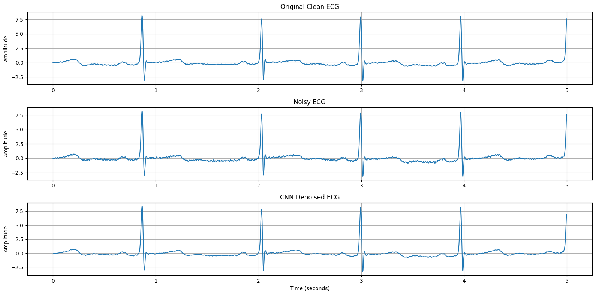
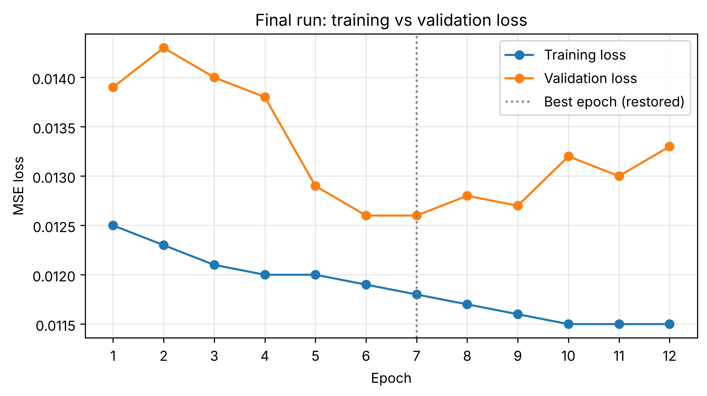

# ECG Signal Denoising using a 1-D Convolutional Autoencoder

A lightweight 1-D convolutional autoencoder (259,841 parameters, about 1 MB) that removes baseline wander, 50 Hz power-line interference and EMG-like noise from single-lead ECG windows from the MIT-BIH Arrhythmia Database.

## Results

Evaluated on unseen test records 115 and 116:

| Metric | Noisy input | Denoised output | Change |
|:-------|:-----------:|:---------------:|:------:|
|  MSE | 0.01499 | 0.01307 | 12.9% lower |
|  MAE | 0.1039 | 0.0937 | 9.8% lower |
|  RMSE | 0.1224 | 0.1143 | 6.7% lower |
|  PRD (%) | 12.24 | 11.43 | 0.81 points lower |
|  SNR (dB) | 18.24 | 18.92 | +0.67 dB |

## Approach

- **Data:** MIT-BIH Arrhythmia Database, lead MLII, read with WFDB
- **Windows:** 1800 samples (5 s at 360 Hz), z-score normalised, up to 150 windows per record
- **Synthetic noise:** baseline wander (0.5 Hz), power-line (50 Hz), EMG-like band-limited noise (20-100 Hz)
- **Split by record, not by window:** 42 training, 2 validation (113, 114) and 2 test (115, 116) records, so no patient appears in more than one set
- **Model:** 3 Conv1D encoder blocks (32, 64, 128 filters) and 3 decoder blocks, kernel size 7
- **Training:** MSE loss, Adam (lr 1e-3), batch size 32, early stopping (patience 5)
- **Tools:** Python, TensorFlow/Keras, SciPy, NumPy, scikit-learn, WFDB, Matplotlib

## Notebook

`ecg_denoising.ipynb` contains the full code with outputs already saved, so the results can be read without running it. It also includes classical-filter baselines and an R-peak detection experiment.
